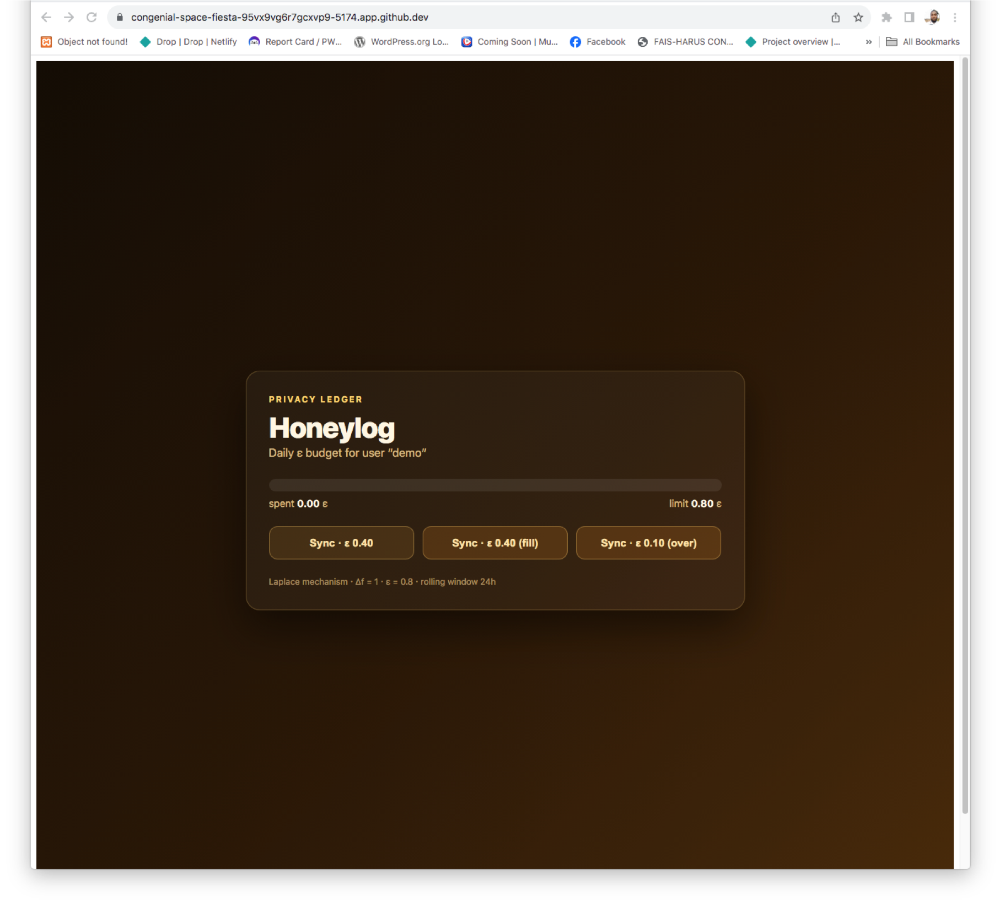

# Honeylog

**Consent-first, on-device memory journal for Bee — private, searchable highlights of your day that never leave your phone.**

[](https://github.com/dejaydanjuma/honeylog/actions/workflows/ci.yml)



---

## The problem

Wearables that remember your day do it by shipping raw audio and transcripts to the cloud. For a device that clips to your collar and hears everything, that is surveillance dressed as convenience. Users want a memory aid — what did I promise at lunch, where did I park, what was that book — not an archive they can't see or control.

## What Honeylog does

Honeylog keeps capture, transcription, embeddings, and search **on-device**, and syncs only coarse salience buckets under a stated differential-privacy budget. Audio never crosses the phone-to-cloud boundary. Transcripts never leave the phone.

```text
Bee audio -> VAD -> Whisper-tiny -> moment extraction
          -> on-device embedding -> salience score
          -> SQLite + sqlite-vec (local)
          -> optional sync: salience buckets only -> AWS
```

## The ranking

Every moment is scored by relevance, recency, and a category prior:

$$
s(q,m) = \cos(e_q, e_m) \cdot \gamma^{\Delta t(m)} \cdot \pi_{c(m)}
$$

- gamma = 0.94 per day — recency decays, but slowly
- The category prior boosts commitments (1.50), people (1.35), locations (1.20) over ambient chatter (0.60)

This is what makes the product useful rather than a recording: a promise made three days ago outranks background noise from this morning.

## The privacy math

Only per-day salience histograms leave the device, with Laplace noise:

$$
\mathcal{M}(D) = \mathrm{hist}(D) + \mathrm{Lap}\!\left(\frac{\Delta f}{\epsilon}\right), \quad \Delta f = 1
$$

with a daily budget of epsilon = 0.8, delta = 1e-6. A per-user ledger charges each sync and **refuses** requests that would exceed the cap — it does not silently truncate. The dashboard renders that ledger directly, so the privacy spend on screen is the real spend.

**This is enforced by tests, not asserted in prose:**

- `cloud/tests/test_budget.py::test_exceeding_cap_raises_with_available_amount` — the epsilon cap
- `cloud/tests/test_budget.py::test_partial_window_expiry` — rolling-window semantics
- `cloud/tests/test_dp.py::test_laplace_variance_matches_theory` — noise verified against the Laplace variance

## Repository layout

```text
honeylog/
├── core/          Rust: scoring, ranking, DP primitives  <- tested, CI-enforced
├── android/       Kotlin scaffold + generated uniffi bindings
├── ios/           Swift scaffold + generated uniffi bindings
├── cloud/         FastAPI sync endpoint + epsilon ledger  <- tested, CI-enforced
├── dashboard/     React privacy ledger — visualizes ε spend live
├── models/        whisper-tiny / int8 artifacts (Git LFS)
├── .github/       CI: fmt + clippy + cargo test, pytest
| Dashboard privacy ledger (`dashboard/`) | visualizes ε spend, refuses over-budget syncs |

```

### What's implemented

| Component | State |
|---|---|
| Rust scorer (`core/`) | 8 unit tests, clippy-clean, rustfmt-clean |
| Kotlin + Swift bindings | generated from `core/` via uniffi, FFI symbols verified |
| FastAPI sync + epsilon ledger (`cloud/`) | 21 tests |
| CI | core and cloud jobs on every push |
| Devcontainer | reproducible Rust + Python environment |

### What's scaffolded, not built

The Android app, iOS app, and React dashboard are directory scaffolds. The **shared core they depend on** is real and tested; the platform UI on top of it is not yet written. The README says so deliberately — the interesting engineering is the scorer and the privacy boundary, and both are done.

## The shared core

The ranking logic is written once in Rust and bound into Kotlin and Swift via [uniffi](https://mozilla.github.io/uniffi-rs/), so the two platforms cannot drift. The FFI surface is verified in the built library:

```text
uniffi_honeylog_core_fn_func_score_moment
uniffi_honeylog_core_fn_func_rank
```

### Generated bindings — do not edit by hand

`android/generated/` and `ios/generated/` are produced by uniffi from `core/src/lib.rs`. Regenerate from inside `core/`:

```bash
cd core && cargo build

cargo run --bin uniffi-bindgen generate \
  --library target/debug/libhoneylog_core.so \
  --language kotlin --out-dir ../android/generated

cargo run --bin uniffi-bindgen generate \
  --library target/debug/libhoneylog_core.so \
  --language swift --out-dir ../ios/generated
```

## Running it

All commands assume you are at the repository root.

### Core

```bash
cd core
cargo test
cargo clippy --all-targets -- -D warnings
```

### Cloud

```bash
cd cloud
python -m venv .venv && source .venv/bin/activate
pip install -r requirements.txt
pytest -q
uvicorn app.main:app --reload --port 8000
```

```bash
curl -s localhost:8000/sync -H 'content-type: application/json' -d '{
  "user_id":"u1",
  "histogram":{"person":4,"commitment":2,"ambient":9},
  "epsilon":0.4
}' | python -m json.tool
```

Second call with `epsilon: 0.4` succeeds. Third returns **429** with the remaining budget — that's the cap working.

## Known limitations

Stated plainly, because a privacy claim is only credible if its edges are visible:

- **The ledger store is in-memory.** Per-process, resets on restart. `LedgerStore` is a Protocol; a DynamoDB implementation is the drop-in swap for real deployment.
- **No idempotency key on `/sync`.** A client retrying after a network error pays epsilon twice.
- **The wearable pipeline is a design, not a measurement.** Battery and latency figures come from a prototype, not a shipped device.

## Built with

**Languages:** Rust, Kotlin, Swift, Python, TypeScript

**On-device / ML:** Whisper-tiny, ONNX Runtime, Core ML, sqlite-vec, SQLite, uniffi

**Backend:** FastAPI, AWS Lambda, DynamoDB, S3, Docker

**Platform:** Bee SDK, Android, iOS

**Tooling:** cargo, pytest, GitHub Actions, WebAssembly